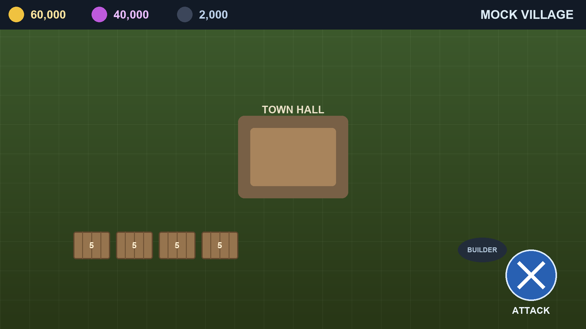

# betterCoC

参考 [BetterGI](https://www.bettergi.com/) 的图像识别分层，为《部落冲突》(Clash of Clans) 搭建的可扩展自动化框架。

当前包含三个任务：

- `raid`：搜索对手、按资源阈值筛选、自动战斗、回营循环。已完成 MuMu 实测。
- `wall_upgrade`：城墙升级，已完成。主界面“建造” → 滑动建造栏 → 城墙 → 批量选择 → 比较金币/圣水余额 → 确认升级。
- `farm_wall`：组合调度。按资源总和阈值决定先升墙还是先打资源，循环到城墙升满，最后打资源到阈值。



## 当前状态

- 截图后端：ADB、图片文件夹、静态图片
- 画面统一归一化到 1920x1080，ROI、模板、点击坐标共用一套坐标
- 模板匹配：ROI、阈值、灰度/三通道、多尺度、Alpha 遮罩、颜色遮罩、NMS
- 固定坐标：`type: point` 直接点击坐标，可带小区域平均颜色校验，按钮位置固定时比模板匹配快且不怕换图标
- 颜色识别：HSV / BGR
- OCR：Tesseract 可选
- 数字模板识别：无需 Tesseract 读取金币、圣水、暗黑数量
- 全局资源：首次加载时回主城、双指缩放到最小视角，读取金币/圣水/暗黑及各自最大储量；`GOLD`、`ELIXIR`、`DARK`、`GOLD_MAX`、`ELIXIR_MAX`、`DARK_MAX` 全局共享
- 资源清单：YAML 声明式识别项，模板懒加载
- 运行时：等待、点击、随机抖动、dry-run、停止信号
- `raid`：状态机、错误恢复、资源筛选、自动战斗、循环上限
- `wall_upgrade`：建造栏入口、滑动查找、批量 +10/+1、金币/圣水余额对比、确认升级、资源状态文件
- `farm_wall`：按资源总和阈值决定先升墙或先打资源，循环到城墙升满，最后把资源补到阈值的 90%
- 运行到建造-城墙栏不再有可升级城墙为止
- 内置模拟器 `demo`，无需游戏即可跑攻击循环
- MuMu 实测：ADB 自动重连、实时截图、真实自动战斗、回营
- 断线重连：识别“还在吗？”弹窗，点击“重新载入游戏”并等待回到主界面
- 城墙卡住：资源足够但升不动时强制重进游戏，关闭开屏弹窗后重试
- 单元测试与模拟器集成测试

真实游戏模板位于 `assets/templates`。仓库中的模板来自当前 MuMu 中文版账号，换账号、语言、分辨率或游戏 UI 后需要重新校准。

## 快速开始

要求 Python 3.10+。

```powershell
python -m venv .venv
.\.venv\Scripts\Activate.ps1
pip install -r requirements.txt
pip install -e .
bettercoc demo --cycles 2
```

`demo` 会生成模拟截图、模板和配置，运行攻击循环，并输出：

```text
演示状态: success
演示结果: 2 轮，进攻 2 次
模拟器数据: 进攻 2 次，剩余金币 900,000，圣水 800,000
输出目录: ...\runtime\demo
```

## MuMu 接入

MuMu 15 的 ADB：

```text
C:\Program Files\Netease\MuMu\nx_device\15.0\shell\adb.exe
```

串口：

```text
127.0.0.1:16384
```

当前机器已写入 [config/mumu.yaml](config/mumu.yaml)。`AdbDevice` 会自动执行 `adb connect`，模拟器重启后不需要手动重连。

```powershell
bettercoc --config config/mumu.yaml doctor
bettercoc --config config/mumu.yaml capture -o runtime/mumu/live.png
bettercoc --config config/mumu.yaml probe --save runtime/mumu/probe.png
```

## 断线重连

游戏长时间无操作会弹出“还在吗？因为太久没有进行操作，您已断开连接。”。任务在回主城、等待战斗结算和读取资源时都会检查这个弹窗：

1. 模板 `game_stop` 命中“重新载入游戏”
2. 点击该链接
3. 关闭随后出现的欢迎弹窗和侧边面板
4. 等待 `home_attack` 出现

```yaml
runtime:
  reload_timeout: 90
```

默认最多等 90 秒；超时仍未回到主界面时，任务沿用原有的恢复流程退出。

`assets/templates/stop.png` 是弹窗原图，`assets/templates/game_stop.png` 是从“重新载入游戏”文字裁出的模板。

## 关闭显示器

只关闭显示器、不进入睡眠时，脚本可以继续运行。ADB 截图和点击都在 MuMu 虚拟机内部完成，不依赖主机显示器是否点亮。

同时需要保证：

- 主机不进入睡眠或休眠
- MuMu 不关闭、不退出
- 不用合盖或电源键关屏，这两种操作通常配置为睡眠；用显示器电源键或系统“仅关闭显示器”即可

当前 [config/mumu.yaml](config/mumu.yaml) 所在机器的交流电设置是“关闭显示器：从不”“睡眠：从不”，手动关闭显示器不会触发睡眠。

## 进攻流程 raid

```text
prepare ──> raid ──> decide ──> raid ...
                │
                └── 达到轮数/时长 ──> finish
```

1. `prepare`：回主城，关闭欢迎弹窗、侧边面板、结算页
2. 点击主城左下角“战斗”
3. 点击“常规战”的“搜索对手”
4. 在“我的军队”确认页点击“进攻！”
5. 等待侦察界面
6. 读取左上角金币、圣水、暗黑
7. 金币 + 圣水 < `min_total` 时点“下一个”，最多 `max_next` 次
8. 达标后点“自动战斗”
9. 等待结算，点“回营”
10. 累计轮数，继续或结束

实测规则：金币 + 圣水 ≥ 2,000,000 才进攻。数字识别由 `assets/digits` 的模板完成，一帧内读完三个数字并立即点击，避免 30 秒侦察倒计时超时。最终实测一轮：第一个目标 184 万被跳过，第二个目标 246 万通过，读取与点击自动战斗在同一秒完成。

细节见 [docs/raid.md](docs/raid.md)。

## 识别项与固定坐标

CoC 在 1920x1080 下绝大多数按钮位置固定，所以按钮改成 `type: point`：直接点固定坐标，不做模板匹配。需要在动作前确认画面状态时，才对固定位置做一次小区域平均颜色校验（`check`），比模板匹配快，也不会因为按钮图标换图而失效。

```yaml
home_attack:
  type: point
  point: [110, 935]          # 点击坐标
  check:                     # 可选：ROI 平均颜色（BGR）与容差
    roi: [60, 1027, 120, 18]
    color: [41, 157, 207]
    tolerance: 25
```

带 `check` 的 point 会让 `find()` 返回命中/未命中，`click()` 等到命中后点击 `point`；省略 `check` 时 `find()` 永远命中，只用于无条件点击。坐标换算成设备坐标后点击，抖动、dry-run、延迟都沿用 `Context.tap()`。

固定坐标（1920x1080，中文版 UI）：

| 名称 | 坐标 | 用途 |
| --- | --- | --- |
| `home_attack` | 110,935 | 主城“战斗” |
| `attack_find_match` | 280,773 | 常规战“搜索对手” |
| `army_attack` | 1695,965 | 我的军队页“进攻！” |
| `scout_next` | 1749,745 | 侦察“下一个” |
| `scout_cancel` | 140,810 | 侦察/战斗页“结束战斗”“放弃”（弹窗变暗时用第二组颜色） |
| `battle_confirm` | 1158,776 | “放弃?”确认弹窗“确定” |
| `battle_return_home` | 961,932 | 结算“回营” |
| `home_popup_close` | 1644,125 | 欢迎回家弹窗 X |
| `side_panel_close` | 1888,35 | 侧边面板 X |
| `exit_cancel` | 746,770 | “确定退出”弹窗“取消” |
| `build_button` | 1832,935 | 主城“建造” |

需要模板或位置会变的项：

| 名称 | 类型 | 用途 |
| --- | --- | --- |
| `auto_battle` | 模板 | 侦察“自动战斗”，整排按钮会随状态移位，所以限制在 `roi: [800,730,820,140]` 内匹配 |
| `game_stop` | 模板 | 断线弹窗“重新载入游戏” |
| `wall_entry` | 模板 | 建造栏里的城墙图标（位置随滚动变化） |
| `max_label` | 模板 | 资源上限弹窗 |

数字项：

| 名称 | 类型 | 用途 |
| --- | --- | --- |
| `home_gold` / `home_elixir` / `home_dark` | 数字 | 主城资源 |
| `loot_gold` / `loot_elixir` / `loot_dark` | 数字 | 侦察界面左上角资源 |
| `wall_cost_gold` / `wall_cost_elixir` | 数字 | 每段城墙成本 |

手动下兵兜底用的 `scout_attack`、`battle_end` 仍是模板项，模板文件还没校准；自动战斗流程不需要它们。

回主城的公共流程在 `bettercoc/recovery.py`：依次处理断线弹窗、侧边面板、欢迎弹窗、侦察/战斗页“结束战斗/放弃”及其“确定”、退出游戏弹窗“取消”、结算“回营”，最后用 `home_attack` 的颜色校验确认主城。画面切换中等待，失败时保存 `ensure-home-failed` 截图。

侦察界面如果没有“自动战斗”按钮（游戏内该功能不可用），任务会结束本次侦察、回到主城并直接报错提示，不会卡在战斗里。

## 配置

`config/mumu.yaml` 关键项：

```yaml
task:
  name: raid
  raid:
    max_cycles: 20
    max_runtime_min: 30
    max_errors: 3
    match_timeout: 45
    battle_start_timeout: 45
    battle_timeout: 240
    result_timeout: 20
    loot_check: true
    min_total: 2000000
    max_next: 15
    auto_battle: true
    army:
      troop_slots: []
      deploy_points: []
```

| 配置 | 说明 |
| --- | --- |
| `task.raid.max_cycles` | 进攻轮数，0 表示只受时长限制 |
| `task.raid.min_total` | 金币 + 圣水最低值，默认 200 万 |
| `task.raid.max_next` | 最多换多少个对手 |
| `task.raid.loot_check` | 是否读取资源并筛选 |
| `task.raid.auto_battle` | 是否点“自动战斗” |
| `task.raid.battle_timeout` | 等待战斗结束的超时 |
| `task.raid.army` | 手动下兵兜底坐标 |

完整说明见 [docs/raid.md](docs/raid.md)。

## 城墙升级 wall_upgrade

流程：

1. `prepare`：回主城，关闭侧边栏/欢迎弹窗
2. 读取主城右上角金币、圣水、暗黑，写入 `runtime/resource-state.json`
3. 点击右下角“建造”
4. 在“建筑和英雄”列表上下滑动，找到“城墙”入口
5. 点击入口，进入城墙升级界面
6. 点击“升级更多”，进入批量选择
7. 读取每段成本，按金币/圣水余额计算能升几段
8. 用“添加城墙 +10 / +1”选到目标数量
9. 优先金币，金币不足时改用圣水
10. 点击升级，确认，扣减内存中的资源
11. 回主城，继续下一批，直到达到 `max_upgrades` 或资源不足

实测：

- 2 段：花费金币 1,200,000，金币 5,800,000 → 4,600,000
- 10 段：金币不足，自动改用圣水 6,000,000，圣水 9,740,620 → 3,740,620
- 状态文件记录升级数量、前后资源、各货币花费

```yaml
task:
  wall_upgrade:
    max_upgrades: 10
    batch_size: 10
    cost_per_wall: 600000
    prefer_currency: auto
    gold_button: [487, 930]
    elixir_button: [707, 930]
```

运行：

```powershell
bettercoc --config config/mumu.yaml run --task wall_upgrade --trace
```

升墙按钮使用固定位置：升级更多 `(925,753)`、+1 `(908,760)`、+10 `(710,755)`、金币 `(487,930)`、圣水 `(707,930)`、确定 `(1168,707)`，并保存到 `runtime/wall-buttons.json`。

完整说明见 [docs/wall-loop.md](docs/wall-loop.md)。

## 打资源 + 升墙 farm_wall

目标：把城墙全部升满，最后把资源补到阈值。

调度逻辑：

1. 初始读取资源：金币 + 圣水总和超过“资源限值 × 90%”时，直接先升墙；此时城墙已满则退出
2. 否则先打一轮资源，再升墙
3. 重复“打资源 → 升墙”，直到没有可升级城墙
4. 城墙升满后，继续打资源，直到金币 + 圣水总和超过“资源限值 × 90%”

资源限值取 `GOLD_MAX + ELIXIR_MAX`，未读取上限时用 `full_gold + full_elixir`；阈值比例由 `threshold_ratio` 控制。

```yaml
task:
  farm_wall:
    full_gold: 10000000
    full_elixir: 10000000
    total_walls: 300
    wall_batch: 0
    threshold_ratio: 0.9
    max_cycles: 0
    max_runtime_min: 0
    max_restarts: 5
    max_raid_retries: 3
```

`wall_batch: 0` 表示按资源计算最大数量。

运行：

```powershell
bettercoc --config config/mumu.yaml run --task farm_wall --trace
```

资源足够但一次也没有升级成功时，会强制退出并重新启动游戏，关闭“欢迎回家”开屏弹窗后重试，最多 `max_restarts` 次。`max_runtime_min` 按单个任务实例计时。

完整说明见 [docs/farm-wall.md](docs/farm-wall.md)。

## 全局资源

`bettercoc/resources.py` 保存全局变量：

```python
GOLD
ELIXIR
DARK
GOLD_MAX
ELIXIR_MAX
DARK_MAX
LOADED
MAX_LOADED
```

首次加载：

1. 回主城，关闭侧边栏和弹窗
2. 用双指 pinch 把视角缩到最小
3. 截图读取右上角金币、圣水、暗黑
4. 依次点击金币、圣水、暗黑，读取提示里的“最大储量”
5. 读取失败重试，失败时使用配置的满值兜底
6. 写入 `runtime/resource-state.json`

`farm_wall` 的资源阈值判断优先使用全局最大储量，不再固定 10,000,000。

任务启动前 `bettercoc run` 会调用 `ensure_loaded`；`wall_upgrade`、`farm_wall` 也会在需要时确保已加载。后续进攻回城后调用 `refresh` 更新，升墙扣费调用 `adjust` 扣减，不在界面打开时反复读资源。

命令行实时查看：

```powershell
bettercoc --config config/mumu.yaml status
bettercoc --config config/mumu.yaml status --live
```

`status` 读取状态文件，`status --live` 回主城重新截图读取。首次读取、进攻后刷新、升墙扣费、城墙数量变化时，CMD 会打印：

```text
+---------------- 资源状态 ----------------+
| 金币 234,789 / 10,000,000
| 圣水 9,400,000 / 10,000,000
| 暗黑 207,500 / 200,000
| 城墙 剩余 237 / 300   已升级 63        |
| 升级城墙 4 段                               |
+------------------------------------------+
```

## 架构

```text
Capture (ADB / Folder / Static)
        │
        ▼
normalize_frame → Screen 1920x1080 + Viewport
        │
        ▼
Vision ── Template / Color / Digits / OCR ──> Match
        │
        ▼
Context / Locator ── wait / click / tap / back / dry-run
        │
        ▼
StateMachine ── prepare / raid / decide / recover
        │
        ▼
Controller (ADB input)
```

| 模块 | 职责 |
| --- | --- |
| `bettercoc/geometry.py` | Rect、Viewport |
| `bettercoc/image.py` | Screen、归一化、读写图 |
| `bettercoc/spec.py` | Recognition 描述 |
| `bettercoc/template.py` | 模板匹配、掩码、多尺度、NMS |
| `bettercoc/color.py` | 颜色范围识别 |
| `bettercoc/digits.py` | 数字模板识别 |
| `bettercoc/ocr.py` | OCR 后端 |
| `bettercoc/assets.py` | YAML 资源清单 |
| `bettercoc/vision.py` | 统一识别入口 |
| `bettercoc/context.py` | 等待、点击、停止、截图 |
| `bettercoc/frame.py` | 帧身份、过期判定、只读帧图像 |
| `bettercoc/locator.py` | 链式定位器 |
| `bettercoc/state_machine.py` | 通用状态机 |
| `bettercoc/events.py` | 诊断事件、错误码、有界事件日志 |
| `bettercoc/recorder.py` | 只读诊断会话录制 |
| `bettercoc/replay.py` | 离线回放与结果对比 |
| `bettercoc/state_store.py` | 观测/诊断状态（来源、新鲜度、原子写入） |
| `bettercoc/baseline.py` | 基线测量、固定测试集执行、环境指纹 |
| `bettercoc/studio/` | Vision Studio 图形界面（可选 PySide6） |
| `bettercoc/tasks/raid.py` | 进攻刷资源任务 |
| `bettercoc/tasks/wall_upgrade.py` | 城墙升级任务 |
| `bettercoc/tasks/farm_wall.py` | 进攻与升墙组合调度 |
| `bettercoc/resources.py` | 全局金币/圣水/暗黑读取与缓存 |
| `bettercoc/console.py` | CMD 资源状态面板 |
| `bettercoc/recovery.py` | 断线重连与游戏重启恢复 |
| `bettercoc/demo.py` | 内置模拟器 |
| `bettercoc/cli.py` | 命令行入口 |

设计细节见 [docs/architecture.md](docs/architecture.md)，MuMu 实测记录见 [docs/mumu-debug.md](docs/mumu-debug.md)。

## BetterGI 对照

| BetterGI | betterCoC |
| --- | --- |
| `captureGameRegion()` | `Context.screen()` |
| `RecognitionObject.templateMatch` | `Recognition(kind=TEMPLATE)` |
| `ImageRegion.find` / `findMulti` | `Vision.find` / `find_all` |
| `BvLocator.waitFor` / `tryWaitFor` | `Context.wait` / `try_wait`，`Locator` |
| `BvPage.getByText` | OCR 识别项 |
| `BvFlow` | `StateMachine` |
| 1080P 坐标 | `vision.canonical_size` |
| `Recognition.json` | `assets/assets.yaml` |

研究笔记见 [docs/bettergi-study.md](docs/bettergi-study.md)。

## 目录

```text
bettercoc/            框架代码
config/mumu.yaml      MuMu 配置
assets/assets.yaml    识别项清单
assets/templates/     模板
assets/digits/        数字模板
docs/                 设计、校准、任务说明
tests/                单元测试与模拟器集成测试
tests/fixtures/       离线固定测试集与标注
scripts/              本地运行与测试脚本
runtime/              日志、截图、演示输出
```

## 测试

```powershell
scripts\test.ps1
```

或：

```powershell
$env:PYTHONPATH = ".deps;."
python -m unittest discover -s tests -v
```

覆盖几何、模板、颜色、数字、OCR 过滤、资源清单、状态机、模拟器进攻循环、固定测试集识别、dry-run 设备输入。

## 基线

`tests/fixtures/baseline` 是离线固定测试集：32 帧历史 MuMu 截图（含缩放、裁切、模糊、亮度、噪声变体），
`manifest.json` 记录每帧的来源、变换和识别项标注。识别直接使用 `assets/assets.yaml`，不改任务默认参数。

```powershell
python -m bettercoc --config config/mumu.yaml baseline --iterations 100
python -m bettercoc --config config/mumu.yaml baseline --iterations 100 --adb-iterations 100
```

第一条只测静态帧路径；加 `--adb-iterations` 才会连设备做只读 `screencap` 采样。输出
`runtime/diagnostics/baseline.json` 与终端摘要，包含环境/资源指纹、固定测试集通过情况、各阶段 P50/P95。
当前结果与接口审查见 [docs/baseline.md](docs/baseline.md)。

重新生成固定测试集：

```powershell
python tools/build_baseline_fixtures.py
```

## 诊断与回放

`record` 生成只读诊断会话（帧 PNG、识别事件、资源指纹、报告），`replay` 用会话里的截图离线重跑识别，
与录制结果逐项对比，全程不连接设备：

```powershell
python -m bettercoc record --frames 8
python -m bettercoc --config config/mumu.yaml replay runtime/diagnostics/sessions/<run_id>
python -m bettercoc --config config/mumu.yaml state
```

- `record` 默认从 `tests/fixtures/baseline` 取帧，加 `--live` 才会从设备只读截图。
- `replay` 输出到会话目录的 `replay-report.json`，分数容差固定 `1e-3`；资源指纹变化会提示 `[WARN]`。
- `state` 读取历史 `runtime/resource-state.json`，按 `source`（observed/estimated/cached/configured）
  与 `status`（valid/stale/unknown）展示，`--write` 另存为诊断状态文件，不覆盖原记录。

## Vision Studio

可选的只读图形界面（PySide6），用于看画面、看识别结果、框选模板、试阈值和回放会话：

```powershell
pip install -e ".[studio]"
bettercoc --config config/mumu.yaml studio
bettercoc studio --source runtime/diagnostics/sessions/<run_id>
```

- 五个页面：Vision（画面 + 识别项 + 匹配框 + 状态/得分/耗时）、Template（框选 + ROI + 阈值试验 + 草稿导出）、
  Replay（逐帧事件 + 复现对比）、Logs（过滤与导出）、Settings（只读配置）。
- 识别状态显示 `matched` / `coordinate_only` / `miss` / `unknown`，不会把固定坐标显示成识别成功。
- 画布等比缩放并留白，框选坐标转换到 1920x1080 canonical。
- 模板导出只写 `runtime/studio/drafts/`，不覆盖正式资源；设备预览只用只读截图。
- 不装 Qt 时 CLI 照常可用。无显示环境可用
  `bettercoc studio --screenshot runtime/studio/main.png --offscreen` 验证。

完整说明见 [docs/vision-studio.md](docs/vision-studio.md)。


## 使用边界

- 脚本会真实消耗搜索金币、兵力和药水，先用小号验证。
- 游戏 UI 更新会导致模板失效。
- 数字模板按当前中文版字体生成，换语言或字体需要重做。
- 自动化可能违反游戏服务条款，风险由使用者承担。

## 后续计划

- 建筑升级、研究、训练任务
- 图形界面与实时识别框
- 多任务调度
- 更强的 OCR 与多分辨率适配
