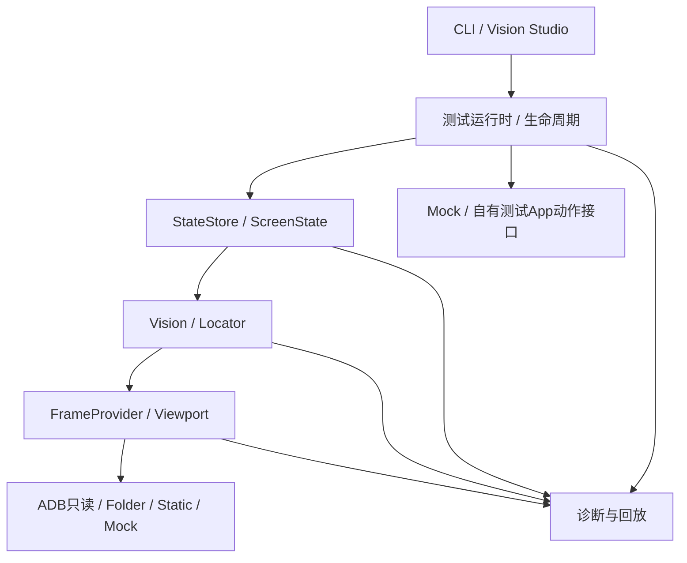

# betterCoC 下一阶段优化实施方案

> 状态：待实施 | 建议版本：V0.2.1 → V0.4.0，后续 V0.5.0
> 依据：当前 README(2).md 及前序 BetterGI 架构讨论。
> 实施原则：增量改造、基线优先、证据驱动、避免重复造轮子。

## 1. 项目现状与目标

当前 README 已记录 ADB / Folder / Static 截图后端、1920×1080 统一坐标、模板/颜色/数字/OCR 识别、YAML 资源、Context / Locator、StateMachine、公共 recovery、资源缓存、CLI、内置 demo 和测试。已有 raid、wall_upgrade、farm_wall 三个任务及部分 MuMu 实测记录。

下一阶段重点不是扩大游戏任务范围，而是完善视觉调试工具、状态一致性和运行时可观测性，使识别失败能够定位、复现、修正和回归验证。保留 Python + ADB + OpenCV 技术路线；不迁移 MaaFramework、不重写为 C#、不预先引入 YOLO、scrcpy 或复杂插件系统。

本文是基于 README 的设计计划，不是源码审计；所有新增接口、版本号及量化门槛均为建议，实施前须结合实际代码确认。游戏自动化可能违反服务条款；新增动作与生命周期机制仅在内置 demo、自有测试 App 或 mock 环境验证，真实游戏侧仅进行被动截图和离线识别，不增加无人值守游戏执行、规避检测或自动重连能力。

## 2. 优先级与目标架构

| 优先级 | 工作包 | 交付物 |
|---|---|---|
| P0 | 基线与诊断 | baseline 报告、固定截图集、耗时统计 |
| P0 | 帧与状态语义 | Frame、StateStore、结构化错误 |
| P0 | Vision Studio | 预览、ROI、模板编辑、识别结果与回放 |
| P1 | 通用测试运行时 | 生命周期、取消、事件、测试动作保护 |
| P2 | 产品化 | 配置管理、资源版本、多分辨率验证 |



保留现有模块路径；新增功能通过适配器接入，不进行全仓库搬迁。现有游戏任务作为兼容性基线，不扩展其执行策略。

## 3. Stage 1 — 基线冻结与性能测量（V0.2.1）

### 3.1 实施任务

- [ ] 检查 git 工作区，记录 commit、Python/依赖版本、配置文件和识别资源版本；不得覆盖用户未提交改动。
- [ ] 执行 README 已有测试命令及 demo，记录真实通过/失败/跳过数量。
- [ ] 审查 Context.screen、Vision、Locator、resources、recovery 的实际调用关系，确认是否存在重复采集、跨帧结果、缓存过期等问题；未确认前仅记为风险。
- [ ] 从已有截图及内置 demo 建立标注集，覆盖正常界面、弹窗、未知界面、模糊数字、相似图标、裁剪及缩放；建议初始至少 30 张，记录来源与预期结果。
- [ ] 分别记录截图传输、解码、归一化、模板匹配、数字识别耗时；建议每组至少 100 次，报告样本数、P50/P95、错误数和运行环境。
- [ ] 检查 dry-run 的所有设备输入路径；使用 mock spy 确认无真实输入。

### 3.2 基线命令（按 README，实际参数以 --help 为准）

```powershell
python -m unittest discover -s tests -v
bettercoc demo --cycles 2
bettercoc --config config/mumu.yaml doctor
bettercoc --config config/mumu.yaml capture -o runtime/mumu/live.png
bettercoc --config config/mumu.yaml probe --save runtime/mumu/probe.png
```

仅在确认 doctor/capture/probe 不触发设备输入后对真实设备调用；否则使用静态截图或 mock。不要调用可能导航游戏界面的 status --live。

### 3.3 验收与输出

输出 `docs/baseline.md`、`runtime/diagnostics/baseline.json`、固定测试集及标注清单。现有测试不得新增失败；已有失败须记录，不得通过删除测试掩盖。性能数值必须来自实际测量，不填写假设性结果。

## 4. Stage 2 — 核心运行时与诊断（V0.3.0）

### 4.1 FrameProvider：明确帧身份

建议新增 `core/frame.py`，复用现有 Screen、Viewport 和 capture 后端。Frame 包含 `frame_id`、`source_id`、`captured_at`、单调时钟、原始尺寸、规范化尺寸、viewport、图像数据；同一诊断批次共享帧，图像只读或明确复制。识别结果携带 frame_id，禁止无提示混用不同帧；提供显式刷新入口，不将缓存旧图标记为新帧。第一版同步实现即可，无需高频后台线程。

- [ ] 检查并保留 Context.screen 原有契约；新增接口通过适配器接入。
- [ ] 对 Folder/Static/Mock 验证帧顺序、坐标往返及失败语义。
- [ ] 为同帧识别与过期帧建立单元测试。

### 4.2 StateStore：区分数据来源

当前 resources.py 使用 GOLD、ELIXIR、DARK、对应 MAX 及 LOADED/MAX_LOADED 全局变量，README 描述 refresh/adjust 和 JSON 持久化。下一步先建立独立的观测/诊断状态模型，不直接替换现有游戏任务的资源更新流程。

建议字段：`value`（可空）、`source`（observed / estimated / cached / configured）、`observed_at`、`frame_id`、`status`（valid / stale / unknown）、`reason`、`schema_version`。缺失不等于零；配置上限不等于实测上限；不要简单以余额超过储量判定识别错误（README 示例已存在此情况）。历史状态文件保留兼容读取，新增诊断状态单独存储，避免覆盖原记录。

- [ ] 测试缺失、过期、配置兜底、读取错误及历史格式。
- [ ] 诊断 JSON 原子写入；写入失败有明确错误，不破坏旧文件。

### 4.3 识别语义与结构化诊断

现有 `type: point` 无 check 时永远命中，因此 Point 仅代表位置，不能被视为目标存在的视觉证据。保留已有配置兼容性，在 Studio 中明确显示 `coordinate_only`、`matched`、`miss`、`unknown`，不得将固定坐标展示为视觉匹配成功。

统一诊断事件建议包含 `run_id`、`event_type`、`timestamp`、`frame_id`、`recognition_id`、`score`、`threshold`、`bbox`、`duration_ms`、`error_code`。区分设备不可用、截图失败、识别缺失、状态未知、超时、用户取消及配置错误。失败证据保存截图与参数摘要；限制日志数量，默认不上传截图或账号信息。

### 4.4 Recorder / Replay

新增只读诊断录制和离线回放。每个会话保存 manifest（配置及资源版本/哈希）、frames、events.jsonl 和 report.json。回放使用记录的截图，不连接 ADB；资源版本不同须明确提示。相同输入与配置的识别结果应一致（浮点分数允许预先声明的容差）。

### 4.5 验收

- [ ] 每个识别结果可关联唯一输入帧。
- [ ] 读取失败、未知状态与合法零值可区分。
- [ ] 模板不匹配、设备断开等异常有明确诊断，不新增游戏恢复动作。
- [ ] 离线回放可复现标注集识别结果，且无任何 ADB 输入。
- [ ] Stage 1 基线通过，更新架构文档。

## 5. Stage 3 — betterCoC Vision Studio（V0.4.0，核心交付）

### 5.1 GUI 技术路线

使用 PySide6 + OpenCV + 现有 bettercoc API；GUI 为可选依赖，CLI 无需安装 Qt 仍可运行。启动默认只读，优先支持 Static/Folder，随后接入 ADB 截图预览。后台采集与识别使用 worker，Qt 主线程只负责展示；队列有界，关闭窗口可释放资源。不要为 GUI 重写 Vision。

### 5.2 页面设计

| 页面 | MVP 功能 | 优先级 |
|---|---|---|
| Vision | 原始/归一化画面、ROI、bbox、得分、识别状态、耗时 | P0 |
| Template Editor | 框选区域、模板预览、阈值试验、导出 | P0 |
| Replay | 会话选择、上一帧/下一帧、事件与识别复现 | P0 |
| Dashboard | 设备连接、截图状态、只读观测值 | P1 |
| Logs | 过滤错误、帧 ID 检索、导出诊断 | P1 |
| Settings | 后端、配置文件及资源包路径 | P2 |

建议布局：左侧导航；中间画布；右侧识别项目及参数；底部事件和耗时。画布应保持宽高比，正确处理留白、缩放与拖动；框选区域转换到 1920×1080 canonical 坐标，不直接使用窗口像素。

### 5.3 实施顺序

- [ ] S3.1 静态图片预览及识别项列表，复用现有 YAML 与 Vision。
- [ ] S3.2 叠加 ROI / bbox / point，显示置信度和识别类型；支持失败项查看。
- [ ] S3.3 框选模板、在离线标注集上验证阈值，显示误检/漏检；导出到新草稿资源目录，不直接覆盖正式配置。
- [ ] S3.4 接入历史会话回放和事件定位。
- [ ] S3.5 接入 ADB 被动预览，显示采集时间与帧龄；断线时标明不可用，不自动执行游戏操作。
- [ ] S3.6 完成 GUI 使用说明及 mock 测试；保持 CLI 兼容。

### 5.4 验收门槛

- [ ] 用户无需改 Python 源码即可完成静态模板裁剪、ROI 调整、阈值试验与草稿导出。
- [ ] GUI 与 CLI 对同一静态帧和配置给出一致识别结果。
- [ ] 至少测试原始尺寸、等比缩放、非等比窗口及留白四种画布情况；坐标往返误差建议不超过 1 个 canonical 像素（整数取整容差）。
- [ ] 静态及 mock 预览连续运行建议 10 分钟，无崩溃、无无界队列增长；关闭窗口后 worker 可退出。
- [ ] 无设备时 GUI 可启动，离线功能可用。
- [ ] 所有预览和回放路径不发出触控、按键或应用重启指令。

## 6. Stage 4 — 通用测试任务运行时（V0.5.0，可选）

在自有测试 App 与 demo/mock 中实现 TaskRegistry、TaskResult、取消令牌、运行时预算及错误分类。生命周期建议 `PENDING → RUNNING → SUCCEEDED / FAILED / CANCELLED / TIMED_OUT`；统一异常和取消报告。仅在 mock/自有 App 的动作测试中加入 ActionGuard 前置条件和结果验证，不扩展真实游戏调度、恢复或自动执行。

- [ ] 单任务生命周期与取消测试。
- [ ] 测试任务之间状态隔离，禁止竞争同一模拟输入接口。
- [ ] 对未知状态、超时、重复提交进行故障注入。
- [ ] 生成运行结果报告，保留现有 CLI 和 demo 兼容性。

## 7. Stage 5 — 产品化（后续，按需求启动）

完善配置校验、资源版本管理、离线多分辨率/语言测试及安装文档。只有基线表明 ADB 采集是主要瓶颈时才评估 scrcpy；只有固定模板与数字识别无法满足离线识别需求时才评估 PaddleOCR 或 ONNX。暂不启动 YOLO、强化学习、通用 Agent、插件市场和多实例游戏自动化。

## 8. 建议新增文件

```text
bettercoc/
  core/
    frame.py
    state_store.py
    events.py
    errors.py
    metrics.py
  diagnostics/
    profiler.py
    recorder.py
    replay.py
    report.py
  studio/
    app.py
    main_window.py
    vision_panel.py
    template_editor.py
    replay_panel.py
    log_panel.py
  # 保留现有 geometry/image/spec/template/color/digits/ocr/
  # assets/vision/context/locator/state_machine/resources/recovery/tasks/cli
 tests/
  # 按现有 unittest 组织新增 frame、state、replay、studio 测试
 docs/
  baseline.md
  architecture.md
  vision-studio.md
 runtime/diagnostics/
```

目录仅为建议，实施时优先复用现有等价文件；不强制创建空模块。runtime 临时数据默认不纳入 git，少量脱敏测试 fixtures 可版本化。

## 9. 执行约束与阶段报告

每次仅实施一个 Stage 或一个子工作包。先阅读实际代码及 tests，给出受影响文件和兼容性风险，再实施最小改动；禁止顺手重构无关模块、覆盖现有资产或更改已有任务默认参数。现有测试框架为 unittest，不为追求测试数量强行迁移 pytest。没有真实设备时使用 mock 并标注未进行设备验证，不伪造实测结果。

每阶段结束输出 `docs/stage-N-report.md`，包括：目标、实际修改、命令及测试结果、性能统计（如适用）、未完成项、已知风险、验收判定和下一阶段建议。通过后再进入下一阶段；出现回归先修复，不能以新增功能掩盖旧问题。

### 第一批实际开发任务

只执行 Stage 1：冻结基线、审查现有接口、建立离线截图集、完成性能统计与 dry-run 验证。暂不实现 GUI 或重构 resources.py。Stage 1 完成后依据测量和代码审查调整 Stage 2 范围，再进入 Vision Studio 开发。

## 10. 最终完成定义

本轮 V0.4.0 的成功不以新增游戏任务数量衡量，而以原有兼容性、识别可复现性、错误可追溯性和视觉校准效率衡量。最终交付应包含可启动的只读 Vision Studio、可复现的离线测试集、完整诊断报告、更新后的 README 与使用文档。未实际验证的项目必须标注未验证，不得宣称达到生产级稳定性。
